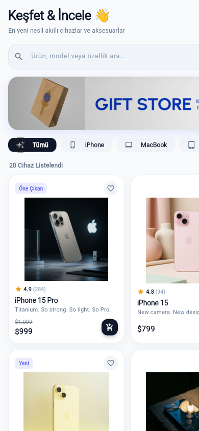
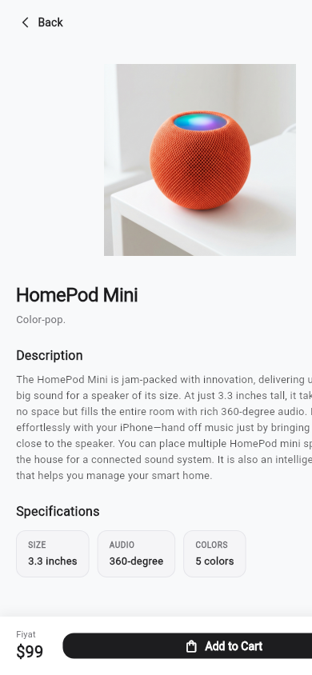
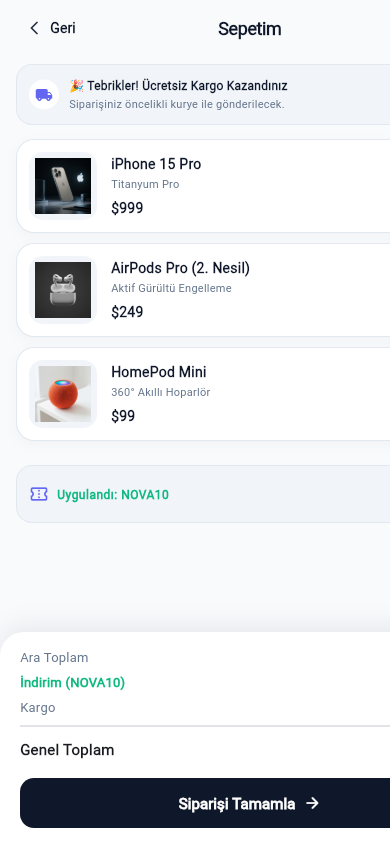
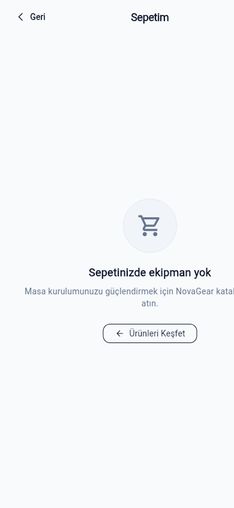

#  MINI KATALOG — Modern Flutter Mobil E-Ticaret Uygulaması

<p align="left">
  
  
  
  
  
  
  
</p>

> **Mini Katalog Uygulaması**, modern mobil geliştirme standartları çerçevesinde **Flutter SDK** ve **Dart** kullanılarak **Android** ve **iOS** platformları için geliştirilmiş; ürün keşfi, dinamik filtreleme, ürün detay incelemesi ve reaktif sepet simülasyonu sunan minimalist, performanslı ve kullanıcı odaklı bir mobil e-ticaret uygulamasıdır.
>
> Proje, harici hiçbir üçüncü parti paket (Provider, Riverpod, Bloc, HTTP vb.) kullanılmaksızın, tamamen Flutter'ın yerel `material.dart` kütüphanesi, yerleşik `ChangeNotifier` durum mimarisi ve Dart standart kütüphaneleriyle sıfır bağımlılık prensibiyle inşa edilmiştir.

---

##  Uygulama Ekran Görüntüleri

| 1. Keşfet (Discover) | 2. Ürün Detayı | 3. Sepet (Dolu) | 4. Sepet (Boş) |
| :---: | :---: | :---: | :---: |
|  |  |  |  |
| **Discover & GridView**<br>Banner, Arama ve Ürün Kartları | **Hero & Specifications**<br>Büyük Görsel, Açıklama ve Donanım | **Sepet Yönetimi**<br>Adet Kontrolü, Toplam & Checkout | **Boş Durum (Empty State)**<br>Alışverişe Yönlendirme |

---

##  Öne Çıkan Özellikler

###  1. Ürün Keşfi ve Dinamik Listeleme (Discover)
-  **Anlık Canlı Arama:** Kullanıcı arama kutusuna yazdıkça ürün adı, sloganı veya açıklamasında gerçek zamanlı filtreleme yapar.
-  **Kategori Filtreleme Çipleri:** `All`, `iPhone`, `MacBook`, `iPad`, `Watch` ve `Audio` sekmeleriyle tek tıkla kategori bazlı listeleme.
-  **Promosyonel Reklam Banner'ı:** Yuvarlatılmış köşeli ve gölgeli *GIFT STORE* öne çıkan fırsat alanı.
-  **2 Sütunlu GridView Mimarisi:** Bellek dostu `GridView.builder` ile akıcı 60/120 FPS ürün kartı listelemesi.
-  **Hızlı Sepete Ekleme:** Kart üzerindeki `+` butonuna basıldığında ürünü anında sepete ekler ve etkileşimli geri bildirim (`SnackBar`) gösterir.

---

###  2. Ürün Detay ve Donanım Özellikleri
-  **Hero Animasyonlu Geçiş:** Katalog kartından detay sayfasına geçerken ürün görseli kesintisiz akıcı bir animasyonla büyür.
-  **Teknik Özellik Kutucukları (`SpecChip`):** Boyut (`SIZE`), ses teknolojisi (`AUDIO`), renk seçenekleri (`COLORS`), yonga seti (`CHIP`) gibi donanım bilgilerini şık kutucuklar halinde sunar.
-  **Tip Güvenli Route Arguments:** Seçilen `Product` veri modeli sayfalar arasında `Navigator` argümanı olarak güvenle taşınır.
-  **Alt Eylem Çubuğu:** Ürün birim fiyatını ve tek tıkla sepete ekleme butonunu sabit alt barda sunar.

---

###  3. Reaktif Sepet ve Sipariş Simülasyonu
-  **Rozetli Sepet Düğmesi (`CartBadgeButton`):** Sağ üst köşede sepetteki anlık ürün adedini gösteren dinamik sayaç rozeti.
-  **Miktar Kontrolleri:** Sepet içindeki ürünleri `+` ile artırma ve `-` ile eksiltme; adet 0'a düştüğünde sepetten otomatik çıkarma.
-  **Otomatik Ara Toplam:** Farklı ürün adetlerine göre toplam tutarı anında dinamik olarak hesaplama.
-  **Sipariş Tamamlama (Checkout Dialog):** Ödeme butonuna tıklandığında sipariş özetini ve onay diyaloğunu gösterip sepeti temizleme.
-  **Kullanıcı Dostu Boş Durum (`EmptyStateView`):** Sepet boşaldığında açıklayıcı mesaj ve tek tıkla keşfet ekranına dönme yönlendirmesi.

---

##  Proje Dizin Yapısı

```
mini_katalog_uygulamasi/
├── android/                         # Android yerel yapılandırması (Gradle, Manifest)
├── ios/                             # iOS yerel yapılandırması (Xcode, Runner)
├── assets/                          # Uygulama varlıkları (Offline-First)
│   ├── data/
│   │   └── products.json            # Mock ürün veri seti (20 Apple cihazı)
│   └── images/
│       ├── banner.png               # Promosyonel GIFT STORE banner'ı
│       └── *.png                    # 20 adet şeffaf ürün görseli
├── screenshots/                     # Gerçek mobil arayüz kanıtları
│   ├── 01_discover_home.png         # Keşfet & GridView ekranı
│   ├── 02_product_detail.png        # Ürün detay ve özellikler ekranı
│   ├── 03_cart_with_items.png       # Dolu sepet ve miktar kontrol ekranı
│   └── 04_cart_empty.png            # Boş sepet yönlendirme ekranı
├── lib/                             # Temiz Mimari (Clean Architecture) Kaynak Kodları
│   ├── main.dart                    # MaterialApp kökü, tema ve rota yapılandırması
│   ├── constants/                   # Sabitler
│   │   ├── app_colors.dart          # Minimalist Apple renk paleti
│   │   ├── app_routes.dart          # Sayfa rotaları sabitleri
│   │   └── app_strings.dart         # Merkezi arayüz metinleri
│   ├── models/                      # Veri modelleri ve serileştirme
│   │   ├── cart_item.dart           # Sepet kalemi ve miktar modeli
│   │   └── product.dart             # Ürün modeli, fromJson, toJson, numericPrice
│   ├── services/                    # İş mantığı ve veri yönetimi
│   │   ├── cart_manager.dart        # ChangeNotifier tabanlı reaktif sepet yöneticisi
│   │   └── product_service.dart     # Yerel asset ve API destekli ürün servisi
│   ├── widgets/                     # Yeniden kullanılabilir atomik bileşenler
│   │   ├── banner_widget.dart       # Promosyon reklam banner'ı
│   │   ├── cart_badge_button.dart   # Rozetli sepet ikonu
│   │   ├── empty_state_view.dart    # Boş sepet durum görünümü
│   │   ├── product_card.dart        # 2 sütunlu ürün kartı
│   │   ├── product_image_view.dart  # Çift katmanlı (Asset/Network) görsel yükleyici
│   │   └── spec_chip.dart           # Donanım özellikleri kutucuğu
│   └── screens/                     # Ana mobil ekranlar
│       ├── home_screen.dart         # Keşfet, arama ve filtreleme ekranı
│       ├── product_detail_screen.dart # Ürün detay sayfası
│       └── cart_screen.dart         # Sepet ve sipariş ekranı
├── test/                            # Otomasyon Testleri
│   ├── unit_test.dart               # Model ve durum yönetimi testleri
│   └── widget_test.dart             # UI ve duman (smoke) testleri
├── pubspec.yaml                     # Bağımlılık ve asset tanımları (Sıfır ek paket)
├── analysis_options.yaml            # Dart kod kalite ve linter kuralları
└── README.md                        # Kapsamlı proje dokümantasyonu
```

---

##  Mimari ve Teknik Standartlar

| Katman / Standart | Uygulama Yaklaşımı | Açıklama |
| :--- | :--- | :--- |
| **Paket Politikası** | `material.dart` (Zero Dependency) | Üçüncü parti durum yönetimi veya HTTP paketleri yerine Flutter'ın kendi sınıfları (`ChangeNotifier`, `dart:convert`, `dart:io`) kullanılmıştır. |
| **Durum Yönetimi** | `ChangeNotifier` & Singleton | `CartManager` sınıfı tüm ekranlar arasında merkezi ve reaktif bir köprü oluşturur. |
| **Sayfa Geçişleri** | `Route Arguments` & `Hero` | Ürün detay ekranına geçerken model nesnesi argüman olarak aktarılır, görsel Hero efektiyle yumuşakça büyür. |
| **Varlık Yönetimi** | `Offline-First` | 20 ürün görseli ve JSON verisi yerel olarak paketlenmiş; internet bağlantısı olmasa dahi uygulamanın eksiksiz çalışması garanti altına alınmıştır. |
| **Platform Odağı** | **Android & iOS** | Yalnızca mobil işletim sistemleri hedeflenerek gereksiz masaüstü/web kodları ayıklanmıştır. |

---

##  Veri Modeli ve JSON Yapısı

```json
{
  "id": 20,
  "name": "HomePod Mini",
  "tagline": "Color-pop.",
  "description": "The HomePod Mini is jam-packed with innovation, delivering unexpectedly big sound for a speaker of its size. At just 3.3 inches tall, it takes up almost no space but fills the entire room with rich 360-degree audio.",
  "price": "$99",
  "currency": "USD",
  "image": "https://wantapi.com/assets/images/homepod_mini.png",
  "specs": {
    "size": "3.3 inches",
    "audio": "360-degree",
    "colors": "5 colors"
  }
}
```

- **`numericPrice` Getter'ı:** `$99` veya `$1,599` gibi biçimlendirilmiş fiyat dizgilerini otomatik olarak sayısal değere (`double`) dönüştürür.
- **`assetPath` Getter'ı:** Uzak URL'den yerel asset yolunu (`assets/images/homepod_mini.png`) türeterek çevrimdışı öncelikli görsel çözümlemesi sağlar.

---

##  Kurulum ve Çalıştırma (Android & iOS)

### 1. Gereksinimler
- **Flutter SDK:** v3.20+ (Proje `v3.50.0` ile test edilmiştir)
- **Dart SDK:** v3.4+
- **Android Studio** (Android SDK & Android Emulator)
- **Xcode** (iOS Simulator - macOS)

### 2. Projeyi Çalıştırma Adımları

```bash
# 1. Proje dizinine geçiş yapın
cd /Users/Ertan/Desktop/mini_katalog_uygulamasi

# 2. Bağımlılıkları güncelleyin
flutter pub get

# 3. Bağlı cihazları listeleyin
flutter devices

# 4. Android Emulator üzerinde çalıştırmak için (Açık emülatörün ID'si ile):
flutter run -d emulator-5554
# veya genel emülatör hedefiyle:
flutter run -d emulator

# 5. iOS Simulator üzerinde çalıştırmak için:
flutter run -d ios
```

---

##  Test ve Doğrulama

Tüm veri modelleri, sepet durum geçişleri ve ekran duman testleri otomatik test paketleriyle doğrulanmıştır:

```bash
# Statik analiz kontrolü (0 hata, 0 uyarı)
flutter analyze

# Otomatik testleri çalıştırma (8/8 Başarılı)
flutter test
```

### Doğrulanan Senaryolar:
-  `Product.fromJson` ve `Product.toJson` serileştirme doğruluğu.
-  `CartManager` ürün ekleme, miktar artırma/azaltma ve sepet boşaltma durum mutasyonları.
-  `HomeScreen` Discover başlığı, arama çubuğu ve ızgara çizim doğrulaması.
-  `CartScreen` boş durum (Empty State) ve buton erişilebilirlik testleri.
